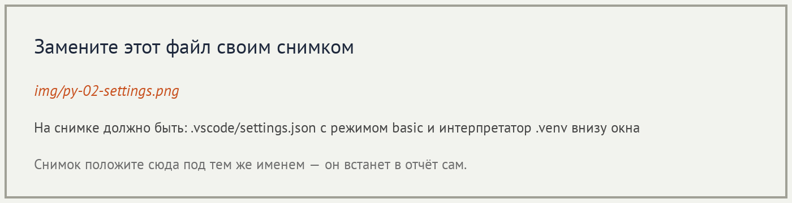
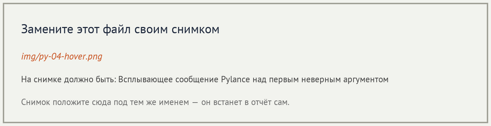
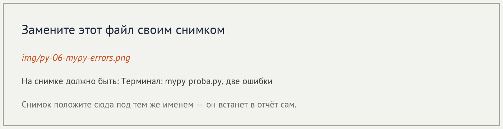
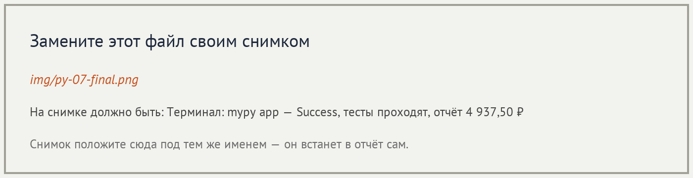

# Отчёт · Проверка типов: Pylance и mypy

**Студент:** Груздев Николай, группа РПО2/25

## 1. Подготовка




## 2. Проверка в редакторе

```python
from app.utils.formatter import format_kopeks, format_title

title = format_title(40)
price = format_kopeks("1250")
```




Разбор сообщения:

| Часть сообщения | Что означает |
|---|---|
| `Argument of type "Literal[40]"` | Передано конкретное число 40. Это частный случай int. |
| `cannot be assigned to parameter "text" of type "str"` | Параметр text функции format_title ожидает строку, число туда не подходит. |
| `Pylance(reportArgumentType)` | Сообщение выдала проверка Pylance по правилу о неверном типе аргумента. |


## 3. Проверка в терминале

```text
mypy 1.15.0 (compiled: yes)
proba.py:3: error: Argument 1 to "format_title" has incompatible type "int"; expected "str"  [arg-type]
proba.py:4: error: Argument 1 to "format_kopeks" has incompatible type "str"; expected "int"  [arg-type]
Found 2 errors in 1 file (checked 1 source file)
```



```text
Success: no issues found in 1 source file
```

## 4. Проект без аннотаций

| Этап | Итог `mypy app` |
|---|---|
| исходно | Found 17 errors in 10 files (checked 15 source files) |
| после `utils` | Found 12 errors in 7 files (checked 15 source files) |
| после `domain` | Found 8 errors in 5 files (checked 15 source files) |
| после `services` | Found 1 error in 1 file (checked 15 source files) |
| после `ui` | Success: no issues found in 15 source files |

Модуль до и после - `app/services/calculator.py`:

```python
def calculate_average(grades):
    ...

def grade_bounds(grades):
    ...
```

```python
def calculate_average(grades: list[int]) -> float:
    ...

def grade_bounds(grades: list[int]) -> tuple[int, int]:
    ...
```

```text
Success: no issues found in 15 source files
12 passed in 0.08s
=========== Смена 12.11.2026 ===========
Петрова Анна                  2 480,50 ₽
Иванов Пётр                   1 685,00 ₽
Сидоров Илья                    772,00 ₽
=========== Итого 4 937,50 ₽ ===========
```



## 5. Выводы

Pylance в режиме basic подчёркивает вызов, если аргумент не совпадает с аннотацией, ещё до запуска. mypy делает ту же сверку в терминале и дополнительно, при `disallow_untyped_defs = true`, находит функции совсем без аннотаций: на первом архиве их было 17. Неожиданным оказалось, что после пакета services оставалась одна ошибка: она была в ui и пропала, когда у функций консоли появились аннотации. Проверка типов не запускает программу и не видит пустой список, деление на ноль и неверный смысл расчёта: это по-прежнему работа тестов.
